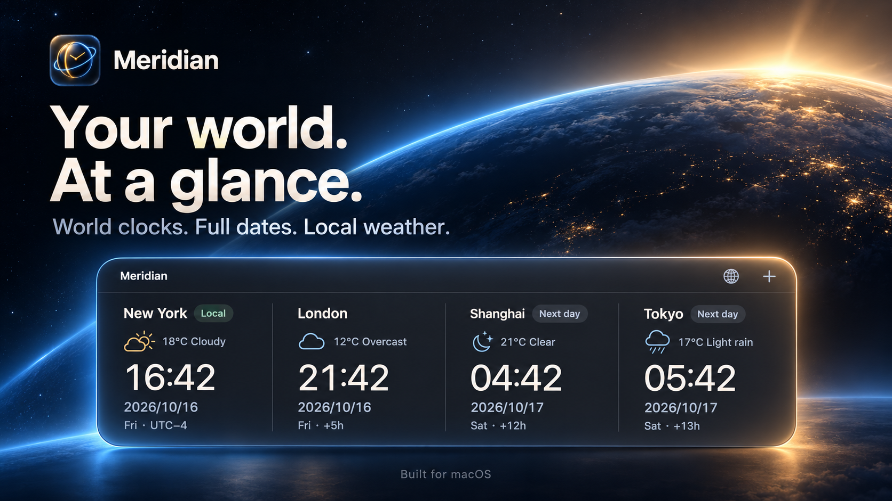

<p align="center"></p>
<h1 align="center">Meridian</h1>
<p align="center"><strong>Your world. At a glance.</strong><br>World clocks, full dates and local weather for your Mac.</p>
<p align="center"><a href="https://etongle.github.io/Meridian/">Website</a> · <a href="https://github.com/etongle/Meridian/releases">Releases</a> · <a href="README.zh-CN.md">简体中文</a></p>



Meridian is a native macOS desktop and menu bar world clock. Keep the places you care about close, with the date and weather right beside the time.

## Features

- **Full dates, everywhere.** Every region shows the year, month, day and weekday. Previous-day and next-day labels make date changes clear.
- **Your clocks, your layout.** Add up to six regions. Choose desktop and menu bar clocks independently, including a single clock or several.
- **A quiet desktop presence.** A dark horizontal widget that you can drag, pin above other windows, lock or hide.
- **One-click overview.** A menu bar panel shows all configured clocks. The panel stays within the screen, with a scrollable clock list on smaller displays.
- **Local weather.** Weather icons and Celsius temperatures refresh every 15 minutes. Missing and outdated data are clearly labeled.
- **English by default.** Switch between English and Simplified Chinese in Settings, without restarting.
- **Sparkle updates.** Automatic checks and optional background downloads are integrated. The signed update channel activates with the first configured release.


## Getting started

Requires **macOS 14 or later**. The current local build targets Apple Silicon; the release workflow builds a universal binary for Apple Silicon and Intel.

1. Get a build from [Releases](https://github.com/etongle/Meridian/releases), or build it locally below.
2. Move `Meridian.app` to Applications and open it.
3. Click **+** to add, remove and reorder clocks. Check **Desktop** and **Menu bar** separately.
4. Click the application icon in the menu bar to see every region. **More** includes position controls, update checks and Quit.
5. Open **Settings** to change the language, weather and update preferences.

The local clock follows your system time zone. Dates use `YYYY/MM/DD`; times use the 24-hour clock. Settings and window position are saved automatically. The original prototype’s bundle identifier is retained so existing preferences continue to work.

## Weather and privacy

Weather is supplied by [Open-Meteo](https://open-meteo.com/). The default endpoint is for non-commercial use. Weather uses the city shown on each clock; the local clock uses the representative city of the system time zone. Meridian does not request device-location permission. Weather can be turned off.

A connection problem never stops the clocks. Cached weather is marked outdated when it is old or cannot be refreshed. Turning weather off replaces it with a simple day/night indicator.

## Build and verify

Install Apple Command Line Tools or Xcode, then:

```sh
zsh build.sh
zsh test.sh
```

The build downloads the pinned **Sparkle 2.10.0** release and verifies its SHA-256 checksum. The generated application is at `dist/Meridian.app`, locally signed for development.

To compile a universal application:

```sh
MERIDIAN_ARCHS="arm64 x86_64" zsh build.sh
```

The checks cover date changes, daylight saving transitions, year boundaries, fractional time zones, city search, weather decoding, localization, update configuration and dropdown placement on small or secondary screens.

## Updates and releases

[Publishing guide](RELEASING.md) explains the signed update workflow, repository secrets and optional Developer ID signing. Release archives and `appcast.xml` are published together on GitHub Releases. Local builds without a public update key keep automatic updates inactive and explain this in Settings.

## Website and assets

`docs/` is a buildless, bilingual GitHub Pages site. English is the default; visitors can switch to Chinese. Download buttons point to the releases page until an actual release archive is available.

The app icon and [English](docs/assets/promo-en.png) / [Chinese](docs/assets/promo-zh.png) launch posters are in this repository. The poster shows example dates and weather. See [brand assets](BRAND.md) for source prompts and usage details.

## Third-party notices

Meridian uses [Sparkle](https://sparkle-project.org/) under its included license and [Open-Meteo](https://open-meteo.com/) for weather data. See [THIRD_PARTY_NOTICES.md](THIRD_PARTY_NOTICES.md).
