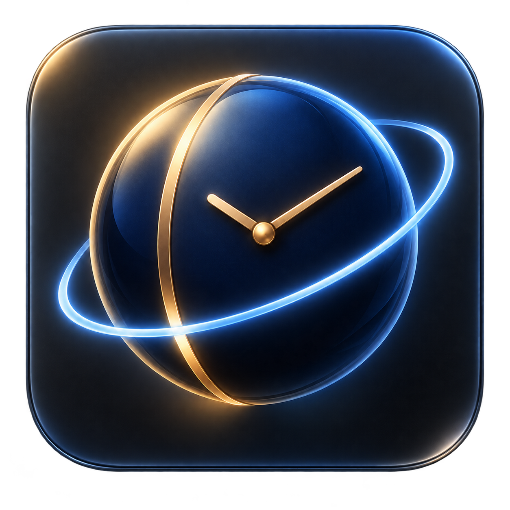
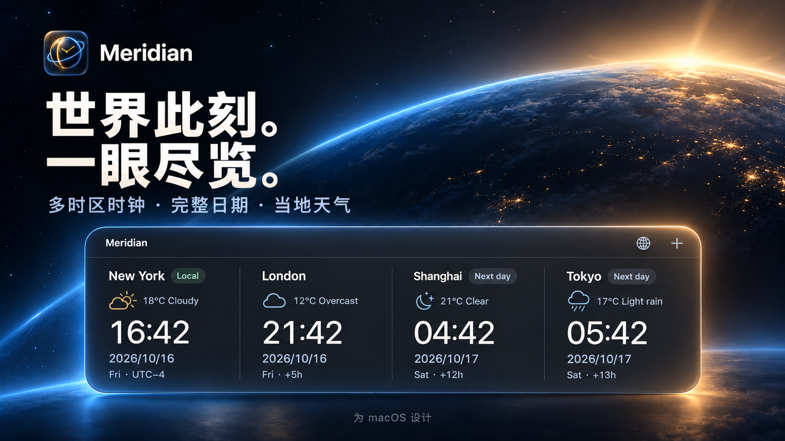
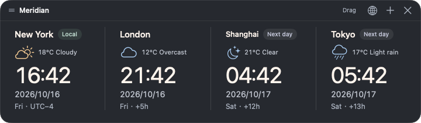

<p align="center"></p>
<h1 align="center">Meridian · 子午线时钟</h1>
<p align="center"><strong>世界此刻，一眼尽览。</strong><br>Mac 桌面与状态栏上的多时区时钟、完整日期和当地天气。</p>
<p align="center"><a href="https://etongle.github.io/Meridian/?lang=zh">官网</a> · <a href="https://github.com/etongle/Meridian/releases">发布版本</a> · <a href="README.md">English</a></p>



## 主要功能

- 可按地理区域浏览 400 多个时区及代表城市，支持中文、英文城市名、国家和时区名称搜索；常用地区置前。
- 每个地区显示完整年月日、星期和 24 小时制时间，跨日标注“前日 / 次日”。
- 日期右侧显示环形秒数：中间显示 00–59，外圈按秒顺时针推进，大号时分保持简洁。
- 默认约 4 个地区，最多 6 个；桌面和状态栏分别选择一个或多个时钟。支持横向、纵向排列，或拆成可单独拖动的独立时钟。
- 只运行一个实例；重复打开会唤起已有应用，复制应用或直接启动也不会产生第二个实例。
- 拖动顶部 Meridian 标题栏移动面板，松手时自动吸附屏幕边缘；支持置顶、锁定位置与隐藏。
- 点击状态栏的应用图标展开全部地区；面板定位在屏幕内，小屏幕可以滚动查看。
- 显示天气图标、摄氏温度和天气状况，每 15 分钟更新。
- 默认英文，可在设置中即时切换简体中文。
- 已集成 Sparkle 签名自动更新，支持自动检查及可选的后台下载。



## 使用

需要 **macOS 14 或更新版本**。发行包为 Apple Silicon 与 Intel 通用版本。

1. 从 [Releases](https://github.com/etongle/Meridian/releases) 下载 **DMG 安装包**。
2. 打开 DMG，将 `Meridian.app` 拖到 **Applications（应用程序）**，然后从“应用程序”打开。
3. 点右上角 **+** 管理地区，分别勾选 **Desktop / 桌面** 与 **Menu bar / 状态栏**。
4. 点状态栏的应用图标 → **Open / 打开**，即可打开或唤起面板；点击桌面面板右上角 **×** 收起到状态栏，应用继续运行。
5. 拖动顶部标题栏调整位置；在 **More / 更多** 中可切换吸附、锁定与置顶，或用 **Find panel (reset position) / 找回面板（重置位置）** 找回面板。
6. 点击标题栏的**布局图标**选择**横向排列 / 纵向排列 / 独立时钟**；也可以在状态栏 **更多** 或 **设置** 中切换。独立时钟分别记忆位置，关闭某一张只收起该时钟；点击 **打开** 恢复全部。纵向较长时可滚动查看。
7. 在 **Settings / 设置** 中切换语言、天气和更新选项。

本地时钟跟随系统时区。日期采用 `YYYY/MM/DD`，设置和位置会自动保存。保留原型版本的应用标识，以延续已有配置。

## 天气与隐私

天气由 [Open-Meteo](https://open-meteo.com/) 提供，默认免费接口用于非商业使用。按时钟所示城市查询，本地使用系统时区对应的城市，不申请设备定位权限。

网络异常不影响时钟。天气缺失或缓存过期会明确标出，也可以关闭天气；关闭后太阳和月亮仅表示当地白天或夜间时段。

## 构建

安装 Apple Command Line Tools 或 Xcode 后执行：

```sh
zsh build.sh
zsh test.sh
```

产物为 `dist/Meridian.app`。构建会下载固定版本 Sparkle 2.10.0 并校验 SHA-256，开发版本使用本地签名。

编译通用版本：

```sh
MERIDIAN_ARCHS="arm64 x86_64" zsh build.sh
```

检查覆盖完整日期、夏令时、跨年、半小时/45 分钟时区、天气、国际化、更新配置、下拉面板定位、布局尺寸与独立时钟的关闭恢复和设置持久化。

## 官网与自动更新

`docs/` 是默认英文、可切换中文的 GitHub Pages 官网。发布流程及签名配置见 [RELEASING.md](RELEASING.md)。安装包、签名更新源、校验和及许可证一起发布到 Releases，同一份制品镜像到 [GitHub Packages](https://github.com/etongle/Meridian/pkgs/container/meridian)。Packages 存储原生 Mac 应用，不是可运行的容器。

首版使用本地 Apple 代码签名，尚未经过 Apple 公证，首次启动可能受 macOS 安全策略限制。Sparkle 签名用于验证更新，不能代替 Apple 公证。

[应用图标与中英文宣传图](BRAND.md) 已包含在仓库中。第三方授权及天气接口说明见 [THIRD_PARTY_NOTICES.md](THIRD_PARTY_NOTICES.md)。

## 授权 — 仅限非商业使用

Meridian 采用 [PolyForm Noncommercial License 1.0.0](LICENSE)。在遵守许可证并保留必要声明的前提下，允许为许可范围内的非商业目的使用、学习、修改和再分发；不授予商业使用权。这属于“非商业源码开放”，不是 OSI 定义的开源许可。

授权覆盖项目原创的应用、源码、官网和美术资源。第三方组件保留各自许可证，参见 [NOTICE](NOTICE) 和 [第三方声明](THIRD_PARTY_NOTICES.md)。

地区目录基于 IANA 数据与 Unicode CLDR 城市译名，离线也可浏览和搜索；时间规则跟随 macOS。旧时区名称会映射到同一地区，避免重复添加。
